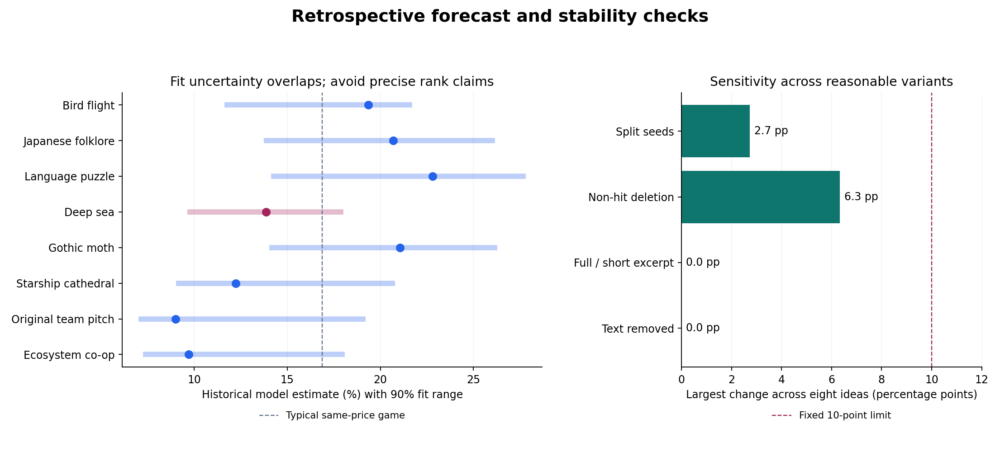

# Stable scoring model

18 October 2026

**All predeclared stability checks pass.**

The final model considers uniformly extracted design evidence, raw tags and the price/age baseline. It assigns 0.0%, 60.0% and 40.0% weight respectively, learned from training-only cross-fitted probabilities. A design-only replacement is not supported by the validation results.

## What was fixed

- Expanded from 300 sampled non-hits to all 1,092 eligible non-hits, alongside all 153 hits: 1,245 games with complete store evidence and no inclusion-weight approximation.
- Every game and idea uses the same title-blind, outcome-blind encoder and a 300-character/seven-tag budget. Up to 20 real-game tags were collected, but only the first seven are scored to match the seven main concept guesses. All positive feature values carry literal evidence spans. Unadvertised traits remain unknown.
- The encoder retains the original 148-column vocabulary. 80 columns have nonconstant literal observations; 44 also meet the 25-example support threshold in the full census. Fold-specific filtering may retain fewer. The final forecast uses 0 design columns after model selection. A store paragraph cannot establish narrative or opposition themes, emotional experience, objectives, intelligence or execution quality, so those inferred families do not enter the forecast.
- The feature views use training-fold frequency filtering (25 observations); all three views use scaling/tuning, cross-fitted calibration and an average over three tuning splits. Blend weights are learned from averaged cross-fitted predictions inside the outer training sets. Rare traits are recorded for description but do not receive forecast coefficients without sufficient support.
- Compared the same model on five split seeds, eight mixed-outcome batch holdouts, five fits deleting 20% of non-hits, and equal-budget concept wording/text-removal variants.
- Refit tuning, calibration and the blend in 200 stratified game-level bootstraps. Duplicate game draws become frequency weights, preventing copies crossing calibration partitions.

## Validation

| Check | AUC | Brier score (lower is better) | Calibration slope (ideal 1) |
|---|---:|---:|---:|
| Combined, nested random folds | 0.858 | 0.0803 | 1.24 |
| Combined, whole mixed batches | 0.856 | 0.0795 | 1.19 |
| Design evidence only | 0.843 | 0.0834 | 1.17 |
| Raw top-seven tags | 0.850 | 0.0799 | 1.19 |
| Price, age, budget/IP controls | 0.843 | 0.0846 | 1.02 |

The blend performs similarly to the tag model. The full-data selection assigns zero design weight. The data do not establish an additional design-based success signal; these are tag-and-baseline forecasts. The trait observations remain descriptive. Text sensitivity is zero because the final forecast excludes that view, not because detailed designs have been validated.

| Stability test | Largest change across the eight concepts | Limit |
|---|---:|---:|
| Changing split seeds | 2.7 percentage points | 10 points |
| Deleting 20% of non-hits | 6.3 percentage points | 10 points |
| Equal-budget full versus short factual excerpt | 0.0 percentage points | 10 points |
| Removing text evidence | 0.0 percentage points | 10 points |

## Idea outputs

These are historical model estimates under a $10–19.99 price band, age set to 24 months, and indie/unlicensed controls. The binary outcome is reaching 500 reviews by 16 October 2026. Age standardization does not create a validated two-year launch forecast. The intervals describe conditional model-fit uncertainty, not the success of a particular unbuilt game.

| Idea | Estimate | 90% fit range | Split-seed range | Non-hit-deletion range |
|---|---:|---:|---:|---:|
| 3D bird-flight platformer | 19.4% | 11.8%–21.6% | 17.9%–19.4% | 17.5%–19.4% |
| Dark Japanese folklore action game | 20.7% | 13.9%–26.0% | 20.5%–21.7% | 19.7%–23.9% |
| Dark language-puzzle metroidvania | 22.8% | 14.3%–27.7% | 22.4%–23.6% | 22.7%–29.1% |
| Deep-sea heat metroidvania | 13.8% | 9.8%–17.9% | 13.0%–14.5% | 13.5%–16.1% |
| Gothic moth platformer | 21.1% | 14.2%–26.2% | 20.7%–21.7% | 20.7%–24.2% |
| Starship-cathedral action game | 12.2% | 9.2%–20.7% | 11.9%–13.8% | 12.1%–15.1% |
| Team pitch: ocean action metroidvania (as written) | 9.0% | 7.1%–19.1% | 8.3%–11.1% | 8.4%–11.3% |
| Two-player ecosystem game | 9.7% | 7.4%–18.0% | 8.9%–11.5% | 9.2%–12.2% |

The same-price, same-age game average is 16.9% (13.3%–19.3%). The concept intervals overlap; the paper should not present a precise ordering as a reliable recommendation.

## Limits and development history

The original mixed-source experiment remains in `design_population.json`, and the first uniform sample experiment in `design_population_uniform_sample.json`. The calibration/census-only step is archived in `design_population_census_single.json`. `design_population_stable.json` contains the final uniform-view comparisons, while `stable_score.json` contains the combined result.

This was an exploratory repair sequence on the same historical outcomes. Nested outer folds exclude their test games from all fitting, but they are not a new, untouched prospective release cohort. Post-launch tags and advertising can reflect success. Keyword rules are operational proxies, not verified expert judgments or understanding of a game's complete design. Titles/developers are excluded from the encoder; subjective unsupported fields are never filled in.

Concept descriptions and tags are hypothetical. The full-versus-short check uses equal 300-character budgets; it is not a claim that every factual detail of a multi-page brief leaves a score unchanged. Additional facts outside that budget remain unknown to this model. Optional mechanics, marketing claims, intended player feelings, comparison games and predicted popularity are excluded from full-brief excerpts.

All bootstrap models retune base C values and blend weights, using independently held-out calibration maps. For compute efficiency, each bootstrap uses one tuning seed per base rather than the final three-seed average. The ranges therefore approximate the final ensemble's fit uncertainty and omit execution, marketing, annotation truth and future market shifts.

## Reproduce from the research workspace

```powershell
python scripts/11a_fetch_design_census.py
python -X utf8 -W error::RuntimeWarning scripts/11_stable_design.py --census --calibrated --ensemble
python -X utf8 -W error::RuntimeWarning scripts/stable_score.py
python -m unittest discover -s scripts -p 'test_design*.py' -v
python scripts/12_stable_report.py
```

`data/curated/pop_batches/stability_plan.md` records the fixed limits and each methodological extension. `output/uniform_design_evidence.json` records feature evidence for every game. `output/stable_score_games.csv` contains the final held-out predictions. Raw census evidence, response timestamps and frozen outcomes are in `data/raw/design_census_*.json`.


